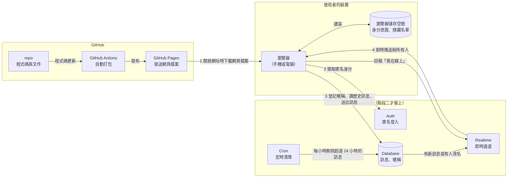
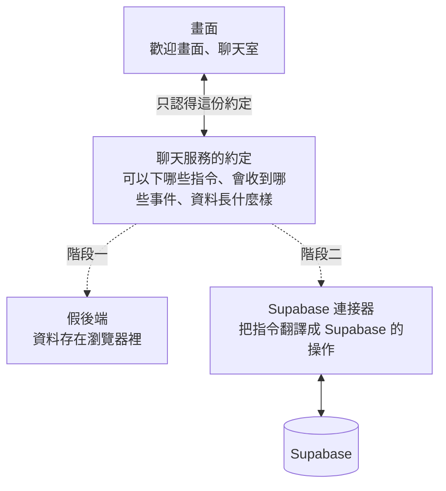
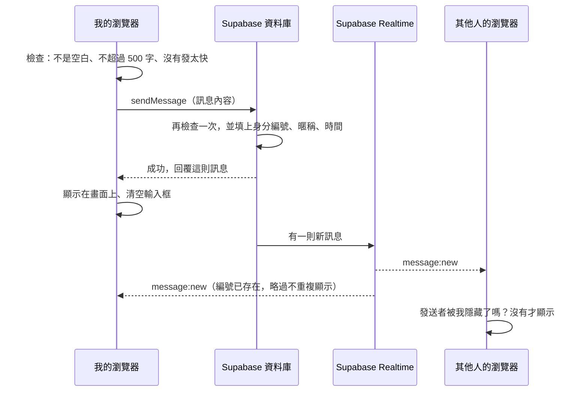

# 匿名聊天室 架構文件

- 文件日期：2026-10-13
- 對應需求：[requirements.md](requirements.md)，加上需求訪談中確認的 29 個決定
- 這份文件只描述「要做成什麼樣子、為什麼這樣做」，不包含程式碼

---

## 1. 專案說明與目標

### 這是什麼

一個打開網址就能聊天的匿名聊天室。不用註冊、不用下載 App，系統會隨機給一個暱稱，所有人在同一個房間裡用文字聊天。主要在手機瀏覽器上使用，電腦也能用。

### 目標

1. **零門檻**：打開網址、按一下「進入聊天室」就能開始聊。
2. **手機優先**：畫面和操作以手機為準，電腦版是同一套畫面置中顯示。
3. **不用花錢**：網頁放在 GitHub Pages，後端用 Supabase 的免費方案。
4. **沒有管理員也不至於失控**：靠字數上限、發言速度限制、純文字、不可點連結、「隱藏這個人」這幾道基本防線。
5. **分兩階段完成**：先做出看得到、點得動的畫面，再接上真正的後端，中間不用重寫畫面。

### 使用者能做的事（訪談結論摘要）

| 主題 | 規則 |
|---|---|
| 進入 | 每次打開都先看到歡迎畫面，按「進入聊天室」才進去 |
| 暱稱 | 隨機產生，可以自己改；1～12 個字；不能跟別人重複（英文大小寫視為相同） |
| 暱稱保留 | 同一個瀏覽器會沿用同一個暱稱；7 天沒回來才釋出給別人 |
| 改名 | 歡迎畫面和聊天室裡都能改；舊訊息仍顯示舊暱稱；一個人最多佔「現在的」和「上一個」兩個名字 |
| 訊息 | 只有文字（含 emoji），最多 500 字，可換行；網址不能點；送出後不能刪、不能改 |
| 歷史訊息 | 進來先看最近 50 則，往上滑可以載入更舊的；訊息只保留 24 小時 |
| 防洗版 | 10 秒內最多 5 則，超過就暫時鎖住輸入框 |
| 線上狀態 | 顯示線上人數，可點開看名單；有人進出時訊息串裡不顯示提示 |
| 隱藏 | 可以隱藏某個人，他的新舊訊息都從我的畫面消失；對方改名也有效 |
| 通知 | 沒有推播、沒有聲音；分頁標題顯示未讀數 |
| 斷線 | 顯示提示、鎖住輸入框、保留打到一半的字；恢復後自動補上漏掉的訊息 |

---

## 2. 整體架構圖

先解釋圖上會出現的幾個名詞：

- **前端**：在使用者瀏覽器裡執行的部分，也就是使用者看到和操作的畫面。
- **後端**：不在使用者裝置上、負責保存資料和轉送訊息的部分。這個專案的後端完全交給 Supabase。
- **repo**（倉庫）：放在 GitHub 上的專案資料夾，裡面有所有程式碼和文件，並記錄每一次修改。
- **GitHub Pages**：GitHub 提供的免費服務，可以把 repo 裡的網頁檔案變成一個公開網址。它只會「發檔案」，不會保存資料、也不會轉送訊息。
- **GitHub Actions**：GitHub 提供的自動化服務，可以設定「每次程式碼更新時，自動做某些事」。這裡用它自動打包並發布網頁。
- **Supabase**：一個雲端後端服務，提供資料庫、即時通訊、登入等現成功能，我們不用自己架伺服器。



讀圖的重點：

- GitHub Pages **只在打開網址的那一刻**出場，把網頁檔案交給瀏覽器後就沒它的事了。
- 之後所有聊天相關的事，都是瀏覽器**直接**跟 Supabase 溝通，中間沒有我們自己的伺服器。
- 因為瀏覽器直接連 Supabase，所以所有「不能被繞過的規則」（字數上限、發言速度、暱稱不能重複）都必須寫在 Supabase 的資料庫裡，不能只寫在前端。原因見第 9 節。

---

## 3. 技術選擇

### 3.1 前端

| 項目 | 選了什麼 | 為什麼 |
|---|---|---|
| 語言 | **TypeScript**：JavaScript（瀏覽器唯一看得懂的程式語言）的加強版，會在寫程式的當下檢查資料格式有沒有對上 | 這個專案的核心是「前端和後端講好的資料格式」（第 5 節）。TypeScript 會在格式對不上時直接報錯，而不是等到使用者遇到才發現。兩個階段要換後端，這層檢查特別有用 |
| 畫面框架 | **React**：目前最多人使用的網頁畫面工具，做法是把畫面拆成一個個小元件（例如「一則訊息」「輸入框」）再組合起來 | 聊天室的畫面會一直變動（新訊息、線上名單、未讀數、斷線提示），用 React 只要描述「資料長這樣時畫面長那樣」，它會自動更新畫面。它的資料和範例最多，之後找人或找工具接手最容易。它預設把所有文字當成純文字顯示，本身就擋掉了最常見的一類攻擊（見 9.1） |
| 打包工具 | **Vite**：把我們寫的 TypeScript 和 React 程式，轉換並壓縮成瀏覽器能直接執行的檔案 | 設定最少、速度快，並且有「開發時預覽」和「產生正式檔案」兩種模式，正好對應本機測試和部署 |
| 樣式 | 一般的 **CSS**（控制網頁外觀的語言），不加額外的樣式框架 | 畫面只有兩個，不需要大型樣式工具。實際的顏色和樣式留給 `/design` 階段決定 |
| 資料狀態管理 | 只用 React 內建的功能，不加額外套件 | 畫面少、資料種類少（訊息、線上名單、我的身分、隱藏名單、連線狀態），內建功能就夠 |
| 頁面切換 | 不使用「路由」（用不同網址對應不同畫面的機制），歡迎畫面和聊天室是同一個網址下的兩個狀態 | 需求是「每次打開都先到歡迎畫面」，所以不需要能直接連到聊天室的網址。也順便避開 GitHub Pages 在多網址網站上常見的「重新整理後找不到頁面」問題 |

### 3.2 Supabase 用到的功能

| 功能 | 一句話解釋 | 用來做什麼 | 為什麼選它 |
|---|---|---|---|
| **Auth 的匿名登入** | 不用帳號密碼，Supabase 直接發給這個瀏覽器一組身分憑證 | 讓每個瀏覽器有一個固定、無法假冒的身分編號 | 「同一個瀏覽器沿用同一個暱稱」「10 秒 5 則」「隱藏這個人」都需要認得出「這是同一個人」。如果讓前端自己編一個編號，任何人都能謊報別人的編號；匿名登入的編號是 Supabase 發的，資料庫可以信任 |
| **Database** | 一個 PostgreSQL 資料庫（PostgreSQL 是一種常見的資料庫軟體） | 保存訊息、暱稱和暱稱的保留期限 | 「進來看得到最近 50 則」「暱稱保留 7 天」都需要把資料存下來 |
| **資料庫函式** | 寫在資料庫裡的一小段規則，前端只能請它執行，不能改它 | 送出訊息、登記暱稱、改名都透過函式進行，由函式檢查字數、速度和暱稱是否重複 | 前端的檢查可以被繞過（見 9.2），規則必須放在使用者碰不到的地方 |
| **Row Level Security**（簡稱 RLS） | 資料庫的逐筆權限規則，規定「誰可以讀、寫哪些資料」 | 規定所有人只能「讀」訊息和暱稱，不能直接新增、修改、刪除，只能透過上面的函式 | 這是「金鑰可以公開」的前提（見第 8 節） |
| **Realtime 的 Postgres Changes** | 資料庫有新資料時，自動通知所有連線中的瀏覽器 | 推送新訊息、推送有人改名 | 訊息先寫進資料庫、通過所有檢查之後才推送出去，所以推送出來的每一則都是合法的。另一種做法（讓瀏覽器之間直接廣播）速度快一點，但任何人都能廣播假冒別人暱稱的訊息 |
| **Realtime 的 Presence** | 追蹤「現在有哪些人連著」的功能 | 線上人數和線上名單 | 這正是它設計的用途；有人斷線時它會自動通知其他人，不用自己寫偵測 |
| **Cron** | 資料庫內建的定時工作 | 每小時刪除超過 24 小時的訊息 | 訊息只保留 24 小時；順便讓資料庫不會越來越大 |

### 3.3 沒有用到的 Supabase 功能

- **Storage（檔案儲存）**：不能傳圖片和檔案，所以不需要。
- **Edge Functions（在 Supabase 上執行的自訂程式）**：資料庫函式已經足夠處理所有規則，少一個要維護的地方。

---

## 4. 兩個階段

### 4.1 階段一：還沒接 Supabase

**目標**：所有畫面和操作都做完，在 GitHub Pages 的網址上點得動，只是「其他人」是假的。

做法是在前端裡放一個**假後端**：一段跟真後端行為相同、但資料只存在自己瀏覽器裡的程式。畫面完全不知道自己面對的是假後端還是真後端。

階段一要做到的程度：

| 功能 | 階段一的狀況 |
|---|---|
| 歡迎畫面、隨機暱稱、改名、暱稱格式檢查 | 完整可用 |
| 暱稱不能重複、保留 7 天、最多佔兩個名字 | 規則完整，但「別人」只限同一台裝置上的其他分頁和假人 |
| 發訊息、500 字上限、換行、10 秒 5 則 | 完整可用 |
| 歷史訊息、往上滑載入更舊的、24 小時後消失 | 完整可用，資料存在自己的瀏覽器裡 |
| 新訊息提示、自動捲動、分頁標題未讀數 | 完整可用 |
| 線上人數與名單、隱藏與取消隱藏 | 完整可用 |
| 斷線提示與恢復 | 完整可用，用測試面板模擬 |
| 不同手機之間互相聊天 | **做不到**，這是階段二的事 |

為了在沒有真人的情況下看得到效果，階段一多做三個輔助功能，只在示範模式出現：

1. **同一台裝置開多個分頁可以互相聊天**。在網址後面加上 `?as=b` 這類參數，那個分頁就會被當成另一個人，可以用兩個分頁測試撞名、隱藏、線上名單。
2. **假人**：幾個會自動說話的假使用者，用來測試新訊息提示、未讀數、洗版時的畫面。
3. **測試面板**：畫面角落的小面板，可以「模擬斷線／恢復」「讓假人說話」「把時間快轉 8 天」（用來測試暱稱過期）「清空資料」。

示範模式下，畫面上會固定顯示一行字：「示範模式：訊息只存在你這台裝置上」，避免有人誤以為這是真的聊天室。

**怎麼在 GitHub Pages 上看到效果**：階段一就把第 12 節的自動部署設定好。每次程式碼更新，GitHub 會自動打包並發布，幾分鐘後用手機打開網址就能看到最新的示範版。

### 4.2 階段二：接上 Supabase 之後

| 改變的部分 | 階段一 | 階段二 |
|---|---|---|
| 身分 | 前端自己編的編號，存在瀏覽器 | Supabase 匿名登入發的編號 |
| 訊息和暱稱存在哪 | 自己的瀏覽器 | Supabase 資料庫 |
| 訊息怎麼傳到別人那裡 | 只能傳到同一台裝置的其他分頁 | 透過 Supabase Realtime 傳給所有裝置 |
| 規則由誰把關 | 假後端（在前端裡） | 資料庫函式和 RLS |
| 線上名單 | 同一台裝置的分頁加上假人 | 所有連線中的真人 |
| 金鑰 | 不需要 | 需要專案網址和公開金鑰（見第 8 節） |
| 假人、測試面板、示範模式提示 | 顯示 | 不顯示 |

**不變的部分**：所有畫面、所有操作、所有提示文字、第 5 節的通訊約定。

### 4.3 前端怎麼設計才不用重寫

核心做法：**畫面永遠只跟一個「聊天服務」講話，不直接碰 Supabase，也不直接碰瀏覽器儲存空間裡的假資料。**



具體有四條規則：

1. **先寫約定，再寫畫面**。第 5 節的指令、事件、資料格式會先寫成一份 TypeScript 定義檔。假後端和 Supabase 連接器都必須符合這份定義，TypeScript 會自動檢查。
2. **畫面的程式碼裡不能出現 Supabase**。所有跟 Supabase 有關的程式集中在一個資料夾，階段二只新增這個資料夾，不修改畫面。
3. **用一個設定值切換**。設定值是「示範」時用假後端，是「正式」時用 Supabase 連接器。如果設定成正式但沒有提供金鑰，自動退回示範模式，而不是顯示空白畫面。
4. **假後端要認真模擬**。它必須回傳跟真後端一樣的錯誤（暱稱被用了、發太快了）、一樣有延遲、一樣會斷線。假後端太理想化，畫面就會漏做錯誤處理，到階段二才發現要補。

只跟畫面有關的規則留在畫面這一層，兩個階段共用，不放進後端：自動捲動、未讀數、隱藏名單的過濾、日期分隔線、輸入框鎖定的倒數。

---

## 5. 通訊約定

這一節是前端和後端之間的約定。階段一由假後端遵守，階段二由 Supabase 連接器遵守。

名詞說明：

- **指令**：前端請後端做一件事，後端會回覆成功或失敗。
- **事件**：後端主動通知前端「發生了某件事」。
- **JSON**：一種用文字表示資料的通用格式，下面的資料範例都用它表示。

### 5.1 指令（前端 → 後端）

| 指令名稱 | 什麼時候用 | 帶什麼資料 | 成功時回覆 | 可能的錯誤 |
|---|---|---|---|---|
| `identify` | 打開網頁時，查詢「我是誰」 | 無 | 我的身分狀態（見 5.4） | `network_error` |
| `enter` | 按下「進入聊天室」 | 想用的暱稱 | 我的個人資料、最近 50 則訊息 | `nickname_taken`、`nickname_invalid`、`network_error` |
| `rename` | 在聊天室裡改名 | 新暱稱 | 我的個人資料 | `nickname_taken`、`nickname_invalid`、`not_connected` |
| `sendMessage` | 按下「發送」 | 訊息內容 | 剛送出的那則訊息 | `rate_limited`、`message_invalid`、`not_connected` |
| `loadOlder` | 往上滑到頂 | 目前畫面上最舊那則訊息的時間 | 更舊的最多 50 則訊息，以及「還有沒有更舊的」 | `network_error` |
| `loadSince` | 斷線恢復後補訊息 | 目前畫面上最新那則訊息的時間 | 這之後的訊息，最多 200 則；超過時改回傳最新 50 則並標記「中間有缺漏」 | `network_error` |
| `lookupProfiles` | 需要知道某些人現在的暱稱 | 一組身分編號 | 這些人的個人資料 | `network_error` |
| `leave` | 關閉或離開頁面 | 無 | 無 | 無 |

### 5.2 事件（後端 → 前端）

| 事件名稱 | 什麼時候發生 | 帶什麼資料 |
|---|---|---|
| `message:new` | 有人（包含自己）送出了一則訊息 | 一則訊息（見 5.3） |
| `presence:sync` | 線上名單有變動 | 目前所有在線者的身分編號 |
| `profile:updated` | 有人改名了 | 那個人的個人資料 |
| `connection:changed` | 連線狀態改變 | `connecting`（連線中）、`online`（已連線）、`offline`（已斷線）三者之一 |

### 5.3 資料格式

**一則訊息**

```json
{
  "id": "8f1c2d3e-4a5b-4c6d-8e9f-0a1b2c3d4e5f",
  "userId": "3b9d6f1a-2c4e-4f8a-9b0c-1d2e3f4a5b6c",
  "nickname": "愛睏的水獺",
  "body": "大家好",
  "createdAt": "2026-10-13T06:32:10.123Z"
}
```

| 欄位 | 意思 | 由誰填 |
|---|---|---|
| `id` | 這則訊息的唯一編號，前端用它避免同一則訊息顯示兩次 | 後端 |
| `userId` | 發訊息的人的身分編號。畫面用它判斷「這是不是我發的」和「這個人有沒有被我隱藏」 | 後端，依登入身分填入，前端無法指定 |
| `nickname` | 發訊息**當下**的暱稱。之後改名不會改到這裡，所以舊訊息顯示舊暱稱 | 後端，從個人資料帶入，前端無法指定 |
| `body` | 訊息內容，純文字，可以包含換行 | 前端提供，後端檢查 |
| `createdAt` | 送出時間，使用世界標準時間；畫面顯示時再換算成使用者當地時間 | 後端。使用後端的時鐘，使用者手機時間不準也不會讓訊息順序錯亂 |

**個人資料**

```json
{
  "userId": "3b9d6f1a-2c4e-4f8a-9b0c-1d2e3f4a5b6c",
  "nickname": "愛睏的水獺"
}
```

**線上名單**

```json
{
  "userIds": [
    "3b9d6f1a-2c4e-4f8a-9b0c-1d2e3f4a5b6c",
    "c7e8f9a0-1b2c-4d3e-8f4a-5b6c7d8e9f0a"
  ]
}
```

線上名單只帶身分編號，暱稱由前端用 `lookupProfiles` 另外查。原因見 9.3。

### 5.4 身分狀態（`identify` 的回覆）

| 狀態 | 意思 | 歡迎畫面顯示 |
|---|---|---|
| `new` | 這個瀏覽器沒來過 | 隨機抽一個暱稱，可修改 |
| `returning` | 來過，暱稱還是他的（包含已過期但沒人拿走的情況） | 「歡迎回來，小貓」，可修改 |
| `nickname_lost` | 來過，但暱稱過期後被別人拿走了 | 「你原本的暱稱『小貓』已經被別人使用了」，並重新抽一個，可修改 |

### 5.5 錯誤代碼

| 代碼 | 意思 | 畫面顯示 |
|---|---|---|
| `nickname_taken` | 暱稱有人用了，或還在別人的保留期內 | 「這個名字有人用了」 |
| `nickname_invalid` | 暱稱不符合格式 | 依原因顯示，例如「暱稱最多 12 個字」 |
| `rate_limited` | 發言太快，回覆裡會帶「還要等幾秒」 | 「你發太快了，請稍等幾秒」，鎖住輸入框並倒數 |
| `message_invalid` | 訊息是空的或超過 500 字 | 正常情況下前端已經先擋住，這是保險 |
| `not_connected` | 目前斷線中 | 連線中斷提示（見 7.2） |
| `network_error` | 其他連線問題 | 「連線有問題，請再試一次」 |

### 5.6 共用規則

前端和後端必須用**同一套**算法，否則會出現「畫面說可以，後端說不行」的情況。

- **字數怎麼算**：以 Unicode 字元為單位（Unicode 是全世界文字的統一編碼）。一個中文字、一個英文字母、一個一般的 emoji 都算 1 個字。少數由多個符號組合而成的 emoji（例如一家人的圖案）會算成好幾個字，剩餘字數會如實顯示。
- **暱稱**：1～12 個字；前後空白自動去掉；不能全是空白；不能包含換行和看不見的控制符號。
- **暱稱撞名的比對方式**：先把全形英數字轉成半形、英文轉成小寫，再比對。所以「Cat」「cat」「Ｃａｔ」算同一個名字。畫面上仍顯示使用者原本輸入的樣子。
- **訊息**：1～500 個字；不能全是空白或換行；前後空白自動去掉；連續三個以上的換行會縮成兩個。
- **發言速度**：任意連續 10 秒內最多 5 則。
- **歷史訊息**：一次最多 50 則，只回傳 24 小時內的。
- **暱稱保留**：
  - 現在用的暱稱：從最後一次進入聊天室起算，保留 7 天。
  - 上一個暱稱：從改名那一刻起算，保留 7 天。
  - 更早的暱稱：改名當下立刻釋出。
  - 改回自己「上一個」暱稱一定成功，兩個名字會互換。

### 5.7 階段二：約定如何對應到 Supabase

這張表給日後維護的人看，使用者不會感覺到。

| 約定 | Supabase 的實際做法 |
|---|---|
| `identify` | 檢查瀏覽器裡有沒有登入憑證；有的話呼叫資料庫函式 `get_my_status` |
| `enter` | 沒有憑證就先做匿名登入，再呼叫資料庫函式 `enter_room`，接著讀取訊息資料表，最後加入即時頻道 |
| `rename` | 資料庫函式 `rename` |
| `sendMessage` | 資料庫函式 `send_message` |
| `loadOlder`、`loadSince` | 讀取訊息資料表 |
| `lookupProfiles` | 讀取個人資料表 |
| `leave` | 離開即時頻道 |
| `message:new` | Postgres Changes：訊息資料表有新增 |
| `profile:updated` | Postgres Changes：個人資料表有新增或修改 |
| `presence:sync` | 即時頻道 `room:lobby` 的 Presence |
| `connection:changed` | 即時頻道的連線狀態，加上瀏覽器的「上線／離線」通知 |

資料庫裡有三張資料表：

| 資料表 | 存什麼 | 誰可以讀 | 誰可以寫 |
|---|---|---|---|
| 訊息 | 編號、發送者身分編號、發送當下的暱稱、內容、時間 | 所有已取得匿名身分的人，且只讀得到 24 小時內的 | 只有 `send_message` 函式 |
| 個人資料 | 身分編號、現在的暱稱 | 所有已取得匿名身分的人 | 只有 `enter_room` 和 `rename` 函式 |
| 暱稱保留 | 比對用的暱稱、屬於誰、是「現在的」還是「上一個」、保留到什麼時候 | 沒有人可以直接讀 | 只有 `enter_room` 和 `rename` 函式 |

「最後一次進入的時間」只存在暱稱保留表裡，不對外公開，避免別人看得到某個人什麼時候上線過。

---

## 6. 資料流

### 6.1 進入聊天室

**打開網址時**

1. 瀏覽器向 GitHub Pages 下載網頁檔案，顯示歡迎畫面的載入狀態。
2. 前端送出 `identify`。
3. 依回覆顯示歡迎畫面（三種狀態見 5.4）。
   - 新使用者：前端從內建的詞庫隨機組一個暱稱，例如「愛睏的水獺」。這時還沒有向後端登記。
4. 如果 `identify` 失敗（沒有網路）：顯示「連線有問題，請再試一次」和重試按鈕。

**按下「進入聊天室」時**

1. 前端先檢查暱稱格式，不合格就在輸入框下方顯示原因，不送出。
2. 前端送出 `enter`。階段二中，新使用者會在這一步才取得匿名身分，只看了歡迎畫面就離開的人不會佔用名額。
3. 後端檢查暱稱並登記，同時把保留期限更新為「現在起 7 天」。
   - 成功：回覆個人資料和最近 50 則訊息。
   - 暱稱被用了：
     - 如果是系統抽的、使用者沒改過：前端自動重抽再試，使用者不會看到錯誤。
     - 如果是使用者自己輸入的：顯示「這個名字有人用了」，停留在歡迎畫面。
4. 前端加入即時頻道，開始接收 `message:new`、`presence:sync`、`profile:updated`，並回報「我在線上」。
5. 切換到聊天室畫面，捲到最底部。
6. 前端把這 50 則訊息裡，發送者在我隱藏名單上的過濾掉不顯示。

### 6.2 送出訊息



補充說明：

- 按下發送後到後端回覆前，發送按鈕暫時停用，避免連點送出兩則。
- 送出失敗時，輸入框裡的字**保留不清空**，並顯示對應的錯誤（見 5.5）。因為訊息送出後不能刪，寧可讓使用者再按一次，也不要自動重送造成重複。
- 發言速度由前端先算一次（為了即時鎖住輸入框並顯示倒數），後端再算一次（為了擋住繞過前端的人）。
- 收到別人的新訊息時：
  - 我在最底部：自動往下捲。
  - 我正在往上看舊訊息：畫面不動，「↓ 有 N 則新訊息」的數字加 1。
  - 頁面在背景：分頁標題的未讀數加 1。

### 6.3 離開

1. 使用者關掉分頁、關掉瀏覽器，或切到別的 App 一陣子後被手機系統切斷連線。
2. 前端有機會的話會送出 `leave`；沒機會送也沒關係，連線中斷本身就會讓 Supabase 知道。
3. Supabase 通知其他人線上名單有變動（`presence:sync`）。
4. 其他人的前端**先等 30 秒**才把他從名單和人數裡移除。30 秒內他又連回來就當作沒離開過，避免網路不穩時名字在名單上閃來閃去。
5. 訊息串裡不顯示任何「離開了」的提示。
6. 他的暱稱繼續保留 7 天，身分憑證和隱藏名單留在他的瀏覽器裡。
7. 輸入框裡沒送出的字不保留，下次進來是空的。

同一個人開了兩個分頁時，要兩個分頁都關掉才算離開。

### 6.4 斷線重連

**斷線時**

1. 前端從兩個來源得知斷線：瀏覽器通知「沒有網路了」，或即時頻道回報連線中斷。
2. 發出 `connection:changed`，狀態為 `offline`。
3. 畫面上方出現「連線中斷，正在重新連線…」，輸入框和發送按鈕鎖住，已經打好的字留在輸入框裡。
4. 前端自動重試連線，間隔逐漸拉長（例如 1 秒、2 秒、4 秒，最長 30 秒），避免網路剛恢復時所有人同時湧入。

**恢復時**

1. 重新加入即時頻道，回報「我在線上」。
2. 送出 `loadSince`，補上斷線期間漏掉的訊息。即時通道不會補送斷線期間的訊息，所以一定要主動去資料庫要。
   - 漏掉 200 則以內：全部補上，依時間插入正確位置，用訊息編號去除重複。
   - 漏掉超過 200 則：改為載入最新 50 則，並在缺漏處顯示一行「中間有較早的訊息未顯示」。
3. 重新取得線上名單。
4. 提示消失，輸入框解鎖。
5. 補回來的訊息視同新訊息：我在最底部就自動捲動，否則計入「↓ 有 N 則新訊息」。

**從背景切回來時**

手機瀏覽器把頁面切到背景後，系統常會自己切斷連線，而且不一定會通知網頁。所以每次頁面回到前景，前端都主動檢查一次連線，有問題就走上面的恢復流程。

---

## 7. 畫面清單

只有兩個畫面，加上幾個浮在畫面上的小視窗。這裡只定義「有什麼、做什麼」，顏色、字體、間距、圖示由 `/design` 階段決定。

### 7.1 歡迎畫面

| 元素 | 行為 |
|---|---|
| 聊天室名稱 | 純顯示 |
| 歡迎文字 | 新使用者顯示一般歡迎語；回訪者顯示「歡迎回來，（暱稱）」；暱稱被拿走時顯示「你原本的暱稱『（暱稱）』已經被別人使用了」 |
| 暱稱輸入框 | 預先填好暱稱（隨機抽的或原本的），可以直接修改。超過 12 個字就打不進去 |
| 「重新抽一個」按鈕 | 把輸入框換成另一個隨機暱稱。*這是我加的，方便不想自己取名的人；不需要的話可以拿掉* |
| 錯誤訊息區 | 在輸入框下方，顯示「這個名字有人用了」「暱稱不能是空白」等 |
| 「進入聊天室」按鈕 | 送出暱稱並進入。處理中顯示載入狀態、不能重複按。暱稱格式不合時不能按 |
| 載入狀態 | 剛打開、還在查詢身分時顯示，此時輸入框和按鈕都還不能用 |
| 連線失敗提示 | 「連線有問題，請再試一次」加上重試按鈕 |

### 7.2 聊天室畫面

由上到下分成三區。

**頂部列**

| 元素 | 行為 |
|---|---|
| 聊天室名稱 | 純顯示 |
| 線上人數 | 例如「12 人在線」，即時更新。點了打開線上名單 |
| 我的暱稱 | 顯示我現在的暱稱。點了打開改名視窗 |
| 連線中斷提示 | 平常不顯示。斷線時出現在頂部列下方：「連線中斷，正在重新連線…」，恢復後自動消失 |

**訊息區**

| 元素 | 行為 |
|---|---|
| 訊息串 | 由舊到新往下排，可以上下滑動 |
| 別人的訊息 | 靠左。上方顯示暱稱，旁邊顯示時間（例如 14:32）。同一個人連續發的訊息，只有第一則顯示暱稱。點暱稱打開使用者選單 |
| 我的訊息 | 靠右，跟別人的訊息外觀不同，不顯示暱稱，旁邊顯示時間 |
| 訊息內容 | 純文字，保留換行，太長自動換行。網址不能點。可以長按選取複製 |
| 過長訊息的收合 | 超過 12 行的訊息只顯示前 12 行，加上「顯示全部」。*這是我加的，防止有人用一則全是換行的訊息佔滿畫面，見 9.1* |
| 日期分隔線 | 訊息跨日時，中間插入一行「今天」「昨天」或日期 |
| 載入更舊訊息 | 滑到頂時自動載入更舊的 50 則，載入中顯示提示。載入後畫面停在原本的位置，不會跳動 |
| 已到最早訊息 | 沒有更舊的訊息時，頂端顯示「只保留最近 24 小時的訊息」 |
| 空白狀態 | 完全沒有訊息時顯示「還沒有人說話，來當第一個吧」 |
| 「↓ 有 N 則新訊息」按鈕 | 只在「我往上滑了」而且「有新訊息」時出現在訊息區底部。點了捲到最底並消失。自己滑到最底時也會消失 |
| 缺漏提示 | 斷線太久、中間訊息沒補齊時，在缺漏處顯示「中間有較早的訊息未顯示」 |

**輸入區**

| 元素 | 行為 |
|---|---|
| 輸入框 | 可以打多行，隨內容長高，最多約 4 行，超過就在框內捲動。到 500 字就打不進去 |
| 剩餘字數 | 顯示還能打幾個字 |
| 發送按鈕 | 內容是空白時呈現不能按的狀態。按了送出並清空輸入框 |
| 鍵盤行為 | 手機：Enter 是換行，要按發送按鈕才送出。電腦：Enter 送出，Shift+Enter 換行。使用注音等輸入法選字時按的 Enter 不算送出 |
| 發太快的鎖定 | 輸入框鎖住，顯示「你發太快了，請稍等 N 秒」並倒數，時間到自動解鎖 |
| 斷線的鎖定 | 輸入框和發送按鈕鎖住，已打的字保留 |
| 手機鍵盤彈出時 | 輸入區要貼在鍵盤上方，訊息區跟著縮小，最新的訊息仍然看得到 |

**分頁標題**

- 平常顯示聊天室名稱。
- 頁面在背景時有新訊息：顯示「(3) 聊天室名稱」。
- 回到頁面時歸零。
- 被我隱藏的人發的訊息不計入。

### 7.3 線上名單面板

從頂部列的線上人數點開，可以關閉。

| 元素 | 行為 |
|---|---|
| 標題 | 「在線上（12）」 |
| 線上使用者列表 | 列出所有在線者的暱稱。我自己排在最上面並標示「（我）」。點別人的暱稱打開使用者選單 |
| 「已隱藏的人」區 | 在面板底部。列出所有被我隱藏的人，不管他在不在線上。顯示他現在的暱稱；查不到時顯示隱藏當下的暱稱。沒有隱藏任何人時不顯示這一區 |
| 「取消隱藏」按鈕 | 每個被隱藏的人旁邊一個。點了之後他的訊息（24 小時內的）立刻回到我的畫面上 |
| 關閉 | 點面板外面或關閉按鈕 |

被我隱藏的人如果在線上，仍然算在線上人數裡，也仍出現在線上列表，但會標示「已隱藏」。這樣人數才會跟其他人看到的一致。

### 7.4 使用者選單

點別人的暱稱時出現的小選單。

| 元素 | 行為 |
|---|---|
| 對方的暱稱 | 純顯示 |
| 「隱藏這個人」 | 點了之後，他所有的訊息立刻從我的畫面消失，之後的新訊息也不顯示。短暫顯示「已隱藏（暱稱）」並附一個「復原」 |
| 「取消隱藏」 | 對方已經被我隱藏時，選單顯示這個選項 |
| 關閉 | 點選單外面 |

點自己的暱稱不會出現這個選單，而是打開改名視窗。

### 7.5 改名視窗

點頂部列的我的暱稱時出現。

| 元素 | 行為 |
|---|---|
| 暱稱輸入框 | 預先填好現在的暱稱 |
| 錯誤訊息區 | 「這個名字有人用了」「暱稱最多 12 個字」等 |
| 說明文字 | 「改名後，之前發過的訊息仍會顯示舊暱稱」 |
| 「確定」按鈕 | 送出。成功後關閉視窗，頂部列立刻顯示新暱稱。暱稱沒變時不能按 |
| 「取消」按鈕 | 關閉視窗，不做任何改變 |

斷線時不能改名，確定按鈕會鎖住。

### 7.6 示範模式專用（只在階段一出現）

| 元素 | 行為 |
|---|---|
| 示範模式提示 | 固定顯示「示範模式：訊息只存在你這台裝置上」 |
| 測試面板 | 可收合。按鈕包含「模擬斷線」「恢復連線」「讓假人說一句話」「讓假人洗版」「時間快轉 8 天」「清空所有資料」 |

---

## 8. 金鑰

**金鑰**是一串像密碼一樣的文字，用來向某個服務證明「我有權限使用」。階段一完全不需要金鑰，以下都是階段二的事。

### 8.1 會遇到的金鑰

| 名稱 | 這是什麼 | 怎麼產生 | 可以公開嗎 | 放在哪裡 |
|---|---|---|---|---|
| **Supabase 專案網址** | 這個 Supabase 專案的位址，嚴格來說不是金鑰 | 建立 Supabase 專案時自動產生，在專案的 API 設定頁可以看到 | **可以** | 本機的 `.env.local` 檔，以及 GitHub repo 設定裡的 Actions Variables |
| **Supabase 公開金鑰**<br/>（publishable key，`sb_publishable_` 開頭；舊版叫 anon key） | 讓瀏覽器能連上這個 Supabase 專案的通行證。它**本來就設計成要放在前端**，任何打開網頁的人都看得到 | 同上，在 API 金鑰頁面 | **可以** | 同上 |
| **Supabase 秘密金鑰**<br/>（secret key，`sb_secret_` 開頭；舊版叫 service_role key） | 萬能鑰匙，可以**無視所有權限規則**讀寫刪除資料庫裡的一切 | Supabase 自動產生，在 API 金鑰頁面 | **絕對不行** | **這個專案完全用不到**。不要複製、不要貼到任何檔案、不要貼到任何對話裡 |
| **資料庫密碼** | 直接連進資料庫的密碼 | 建立 Supabase 專案時自己設定 | **絕對不行** | 只存在自己的密碼管理工具裡。這個專案的程式用不到它 |
| **Supabase 帳號密碼** | 登入 Supabase 管理後台用的 | 註冊時設定 | **絕對不行** | 自己的密碼管理工具。建議開啟兩步驟驗證 |
| **GitHub 的部署憑證** | GitHub Actions 發布網頁時用的權限 | GitHub 每次執行時自動產生、用完即失效 | 不用管 | 不需要手動建立或保存任何東西 |

### 8.2 為什麼公開金鑰可以公開

這個專案沒有自己的伺服器，瀏覽器直接連 Supabase，所以公開金鑰一定會出現在網頁檔案裡，藏不住，也不需要藏。

安全不是靠藏金鑰，而是靠資料庫的權限規則（RLS）。拿著公開金鑰的人只能做規則允許的事：讀 24 小時內的訊息、讀暱稱、呼叫那幾個會自己檢查的函式。他不能直接新增、修改、刪除任何資料。

**所以真正重要的是：每一張資料表都必須開啟 RLS。** 有任何一張表忘了開，拿到公開金鑰的人就能對那張表為所欲為。這一項列在第 13 節的驗證清單裡。

### 8.3 怎麼避免金鑰被 commit 到 GitHub

**commit** 是把修改正式記錄進 repo 的動作。記錄一旦推上 GitHub，即使之後刪掉檔案，舊的記錄裡還是找得到。而且要用免費的 GitHub Pages，repo 必須是公開的，等於全世界都看得到。

雖然這個專案前端用到的兩個值都可以公開，還是照標準做法處理，這樣將來如果需要放真正的秘密，流程已經是對的。

1. **設定值放在 `.env.local` 檔案裡**，不直接寫在程式碼裡。這個檔案只存在自己的電腦上。
2. **`.gitignore` 檔案裡列出 `.env.local` 和所有 `.env.*.local`**。`.gitignore` 是告訴版本控制工具「這些檔案不要記錄」的清單。這一步在階段一建立專案時就做，早於任何金鑰出現。
3. **repo 裡放一個 `.env.example`**，只列出需要哪些設定的名稱，值留空。它的用途是說明，可以公開。
4. **部署用的值放在 GitHub repo 設定裡**（Settings → Secrets and variables → Actions → Variables），GitHub Actions 打包時會自動帶入。
5. **確認 GitHub 的 Secret scanning 和 Push protection 是開啟的**。這是 GitHub 的免費功能，偵測到推上來的內容裡有已知格式的金鑰時會擋下來。公開的 repo 預設開啟。
6. **每次 commit 前看一眼要記錄哪些檔案**，確認沒有 `.env.local`。
7. **秘密金鑰和資料庫密碼從頭到尾不進入專案資料夾**。要修改資料庫結構時，把 repo 裡的 SQL 檔案（SQL 是對資料庫下指令的語言）內容貼到 Supabase 管理後台的 SQL 編輯器執行，那裡用的是你的登入身分，不需要任何金鑰。

### 8.4 萬一不該公開的金鑰外洩了

1. **立刻到 Supabase 後台把那把金鑰作廢並重新產生**；資料庫密碼則是重設。這是唯一有效的處理方式。
2. 只把檔案刪掉再 commit 一次**沒有用**，舊的記錄裡還在，而且可能已經被自動掃描的程式抓走了。
3. 檢查資料庫有沒有被動過。

---

## 9. 安全與限制

### 9.1 別人可以送什麼奇怪的東西進來

| 奇怪的東西 | 會怎樣 | 怎麼擋 |
|---|---|---|
| **夾帶網頁程式碼的訊息或暱稱**（例如 `<script>` 這類標籤） | 如果畫面把它當成網頁內容而不是文字，就會在所有人的瀏覽器裡執行，可以偷走身分憑證或竄改畫面。這類攻擊叫 XSS | React 預設把所有內容當純文字顯示，`<script>` 就只會顯示成那幾個字。規定：**程式裡不准使用任何「把文字當成網頁內容插入」的寫法**，這一條列入驗證清單 |
| **釣魚或惡意網址** | 有人誤點 | 網址不轉成連結，只是普通文字 |
| **超長訊息或超長暱稱** | 佔滿畫面 | 前端限制輸入；資料庫函式再檢查一次並拒絕 |
| **全是換行的訊息** | 500 個換行可以佔掉幾十個螢幕高 | 連續三個以上的換行縮成兩個；超過 12 行的訊息預設收合 |
| **一長串沒有空格的字元** | 把畫面撐寬，出現左右捲動 | 訊息區設定成強制換行 |
| **看不見的字元**（零寬空白、控制符號、會讓文字反向顯示的符號） | 做出看起來空白的暱稱，或跟別人看起來一模一樣的暱稱 | 暱稱裡這類字元一律移除後再檢查；訊息裡移除控制符號 |
| **疊加符號**（在一個字上疊幾十個上下標記，俗稱 Zalgo 文字） | 文字溢出到上下好幾行，蓋住別人的訊息 | 每則訊息的顯示範圍限制在自己的框內，超出的部分裁掉 |
| **看起來一樣的不同字**（例如英文的 a 和俄文的 а） | 冒充別人的暱稱 | 全形半形和大小寫已經統一比對，但所有相似字**擋不完**。這是已知限制，見 9.4 |
| **不雅文字** | 冒犯他人 | 這一版不過濾，使用者可以用「隱藏這個人」自保 |

### 9.2 繞過前端直接對 Supabase 下指令

因為公開金鑰是公開的，懂技術的人可以不透過我們的網頁，自己寫程式直接連 Supabase。所以原則是：

> **前端的所有檢查都只是為了讓正常使用者有好的體驗（立刻看到錯誤提示）。真正的把關全部在資料庫。**

| 他想做的事 | 資料庫怎麼擋 |
|---|---|
| 送出超過 500 字的訊息、空白訊息 | `send_message` 函式檢查後拒絕 |
| 一秒送 100 則 | `send_message` 函式計算這個身分最近 10 秒的訊息數，超過就拒絕 |
| 用別人的暱稱或身分發訊息 | 訊息的身分編號和暱稱由函式依登入憑證填入，不接受外部指定 |
| 搶別人保留中的暱稱 | `enter_room` 和 `rename` 函式檢查暱稱保留表；資料庫本身也限制同一個比對用暱稱只能有一筆 |
| 兩個人同一瞬間搶同一個暱稱 | 靠上述的資料庫限制保證只有一個人成功 |
| 囤積一堆暱稱 | `rename` 函式在改名時立刻釋出更早的名字，一個身分最多兩筆 |
| 直接修改或刪除別人的訊息 | RLS 規定任何人都不能直接新增、修改、刪除訊息 |
| 讀取超過 24 小時的舊訊息 | RLS 只允許讀取 24 小時內的訊息，即使定時清理還沒執行到 |

### 9.3 線上名單的弱點

線上名單（Presence）的內容是每個瀏覽器自己回報的，Supabase 不會幫忙驗證。所以：

- 名單裡**只放身分編號**，暱稱一律去資料庫查。這樣沒有人能在名單上顯示假暱稱。
- 懂技術的人仍可以回報別人的身分編號，讓某個不在線的人看起來在線上，或灌入假的身分編號讓人數虛增。這不會影響訊息，也冒充不了別人說話，這一版接受這個弱點。

### 9.4 「不用註冊」帶來的已知限制

這些不是程式錯誤，而是需求本身的代價，要先知道。

- **換一個瀏覽器、清除瀏覽器資料、用無痕模式**，系統都會把他當成新的人。所以：
  - 被隱藏的人換個身分回來，隱藏就失效。
  - 被限速的人換個身分可以繼續發。Supabase 對同一個網路位址每小時能領取的匿名身分數量有上限，可以擋掉大量製造身分，但擋不住偶爾換一次。
  - 自己清除瀏覽器資料後，暱稱要等 7 天過期才拿得回來，隱藏名單也會消失。
- **沒有管理員、沒有檢舉**。真的出現嚴重的不當內容時，唯一的處理方式是專案擁有者登入 Supabase 後台手動刪除訊息。
- **訊息不是私密的**。任何打開網頁的人都讀得到 24 小時內的所有訊息。歡迎畫面上會提醒使用者不要輸入個人資料。
- **身分編號是公開的**。每則訊息都帶著發送者的身分編號，同一個人即使改名，別人仍然可以認出是同一個人。這是「隱藏在對方改名後仍有效」的必要條件。

### 9.5 免費方案的上限

以下數字是撰寫這份文件時的了解，**服務商可能隨時調整，階段二開始前請到官方的方案說明頁再確認一次**。

**Supabase 免費方案**

| 項目 | 上限 | 對這個專案的影響 |
|---|---|---|
| **專案閒置暫停** | 大約 7 天沒有任何使用，專案會被自動暫停 | **最需要注意的一項**。暫停後聊天室會連不上，使用者只會看到「連線中斷」，要登入 Supabase 後台手動恢復。冷門時段長的聊天室很容易碰到 |
| 同時連線數（Realtime） | 約 200 個 | 等於最多約 200 人同時在線（一個人開兩個分頁算兩個）。超過的人會連不上，看到「連線中斷」 |
| 即時訊息數量 | 每月約 200 萬則，每秒約 100 則 | 一則聊天訊息推給 50 個在線者算 50 則。線上名單的變動也計入。以 50 人同時在線估算，每月大約可以發 3 萬多則聊天訊息 |
| 資料庫大小 | 約 500 MB | 訊息只保留 24 小時，幾乎不可能碰到 |
| 每月活躍使用者 | 約 5 萬 | 每個匿名身分算一個。清除瀏覽器資料再進來算新的一個 |
| 流量 | 每月約 5 GB | 純文字，正常使用不會碰到 |
| 匿名登入速度 | 同一個網路位址每小時約 30 次 | 同一個 Wi-Fi 下很多新使用者同時第一次進來時（例如在教室裡），可能有人暫時進不去。回訪的人不受影響 |
| 免費專案數 | 2 個 | 這個專案佔 1 個 |

另外，匿名身分不會自動刪除。資料庫會設一個每日的定時工作，清掉超過 30 天沒回來的匿名身分和他們的暱稱保留記錄。

**GitHub Pages**

| 項目 | 上限 | 對這個專案的影響 |
|---|---|---|
| repo 必須公開 | 免費帳號只有公開的 repo 能用 Pages | 所有程式碼和文件全世界都看得到，這也是第 8 節那麼小心的原因 |
| 網站大小 | 約 1 GB | 這個專案的檔案不到幾 MB |
| 每月流量 | 約 100 GB | 不會碰到 |
| 發布次數 | 每小時約 10 次 | 開發時頻繁更新可能要等一下 |

---

## 10. 這一版刻意不做的事

| 不做的事 | 為什麼 |
|---|---|
| 註冊和登入 | 需求明確要求不用註冊 |
| 多個房間、私訊 | 需求是「大家在同一個房間」。人數不多時分房反而讓每個房間都冷清 |
| 傳圖片、檔案、語音、貼圖 | 匿名又沒有管理員，能傳圖就一定有人傳不當內容，而且無從追究。純文字把風險降到最低，也不需要檔案儲存空間 |
| 可以點的連結 | 匿名環境裡的連結容易被拿來釣魚，手機上又容易誤觸 |
| 刪除、修改訊息 | 聊天室的訊息很快被推上去，需求不高；而且「我的訊息」是靠瀏覽器認人，清掉資料後就再也刪不了，行為會不一致 |
| 檢舉功能 | 容易被一群人用來聯手消音別人；沒有管理員覆核的檢舉弊大於利 |
| 管理員、封鎖、禁言 | 沒有帳號就沒有可靠的封鎖對象，對方換個瀏覽器就回來了，投入的成本和效果不成比例 |
| 不雅字詞過濾 | 很容易用諧音、空格、符號繞過，字詞表的維護成本高、效果有限。改以「隱藏這個人」讓使用者自保 |
| 進出聊天室的提示 | 手機網路常斷線重連，會被「離開了／加入了」洗版 |
| 推播通知、提示音 | 所有人同在一個房間，每則都通知會太吵；而且要先跳出權限詢問，不符合「進去就能聊」 |
| 「正在輸入…」提示、已讀 | 多人房間裡意義不大，卻會大量消耗即時訊息的額度 |
| 回覆特定訊息、標記某人、表情回應 | 第一版先確認基本聊天好用 |
| 訊息搜尋 | 訊息只保留 24 小時，沒有搜尋的必要 |
| 永久保留訊息 | 匿名聊天室裡隨口說的話不應該永遠留著 |
| 多國語言介面 | 只做繁體中文 |
| 獨立的電腦版面 | 需求是手機可用，電腦版用同一套畫面置中 |
| 安裝成手機 App、離線使用 | 聊天本來就需要網路 |
| 人機驗證（證明不是機器人的測驗） | 會在門口多一道關卡。先靠速度限制撐著，真的被機器人灌爆時再加，Supabase 有現成的整合可以開 |
| 自動化測試 | 這一版用第 13 節的清單手動驗證 |

---

## 11. repo 的資料夾結構

```
DDoouu/
├─ docs/
│  ├─ requirements.md            原始需求
│  └─ architecture.md            這份文件
│
├─ src/                          前端程式
│  ├─ main.tsx                   程式的起點
│  ├─ App.tsx                    決定現在顯示歡迎畫面還是聊天室
│  │
│  ├─ screens/                   兩個主要畫面
│  │  ├─ WelcomeScreen.tsx       歡迎畫面
│  │  └─ ChatScreen.tsx          聊天室畫面
│  │
│  ├─ components/                畫面上的小元件
│  │  ├─ TopBar.tsx              頂部列
│  │  ├─ ConnectionBanner.tsx    連線中斷提示
│  │  ├─ MessageList.tsx         訊息串（含捲動、載入更舊訊息）
│  │  ├─ MessageBubble.tsx       一則訊息
│  │  ├─ NewMessagesButton.tsx   「↓ 有 N 則新訊息」
│  │  ├─ Composer.tsx            輸入區
│  │  ├─ OnlinePanel.tsx         線上名單與已隱藏的人
│  │  ├─ UserMenu.tsx            使用者選單
│  │  └─ RenameDialog.tsx        改名視窗
│  │
│  ├─ chat/                      聊天服務（畫面和後端之間的那一層）
│  │  ├─ types.ts                通訊約定：指令、事件、資料格式、錯誤代碼
│  │  ├─ rules.ts                共用規則：字數算法、暱稱與訊息的檢查
│  │  ├─ createChatService.ts    依設定決定用假後端還是 Supabase
│  │  ├─ mock/                   假後端（階段一）
│  │  │  ├─ MockChatService.ts
│  │  │  ├─ bots.ts              假人
│  │  │  └─ DevPanel.tsx         測試面板
│  │  └─ supabase/               Supabase 連接器（階段二才新增）
│  │     └─ SupabaseChatService.ts
│  │
│  ├─ state/                     畫面用的資料狀態
│  │  ├─ chatStore.ts            訊息、線上名單、連線狀態、未讀數
│  │  └─ hiddenUsers.ts          隱藏名單（存在瀏覽器裡）
│  │
│  ├─ lib/                       小工具
│  │  ├─ randomNickname.ts       隨機暱稱的詞庫與產生方式
│  │  └─ time.ts                 時間與日期的顯示
│  │
│  └─ styles/                    樣式（內容由 /design 階段決定）
│
├─ supabase/                     資料庫設定（階段二才新增）
│  └─ migrations/                建立資料表、函式、權限規則、定時工作的 SQL 檔案
│
├─ public/                       不需要處理、原樣發布的檔案（例如網站圖示）
│
├─ .github/
│  └─ workflows/
│     └─ deploy.yml              自動打包並發布到 GitHub Pages 的設定
│
├─ index.html                    網頁的外殼
├─ package.json                  專案用到哪些套件
├─ vite.config.ts                打包工具的設定
├─ tsconfig.json                 TypeScript 的設定
├─ .env.example                  需要哪些設定值的說明（可以公開）
├─ .env.local                    真正的設定值（只在自己電腦上，不進 repo）
└─ .gitignore                    不要記錄進 repo 的檔案清單
```

最重要的一條界線：**`screens/`、`components/`、`state/` 裡的程式只能使用 `chat/types.ts` 和 `chat/rules.ts`，不能直接使用 `chat/mock/` 或 `chat/supabase/` 裡的東西。** 這條界線是「階段二不用重寫畫面」的保證。

資料庫的結構用 SQL 檔案保存在 repo 裡，是為了留下「資料庫現在長什麼樣、是怎麼變成這樣的」的記錄。這些檔案只描述結構和規則，不含任何密碼，可以公開。

---

## 12. 部署到 GitHub Pages 的方式

**部署**是把做好的網頁放到網路上，讓別人用網址打開。

### 12.1 做法

使用 GitHub Actions 自動部署：每次程式碼推上 `main` 分支（`main` 是 repo 的主要版本），GitHub 就自動完成以下步驟。


選這個做法的原因：不用在自己電腦上手動打包上傳；打包出來的檔案不用存進 repo，repo 裡只有原始程式；設定值由 GitHub 在打包時帶入。

### 12.2 一次性的設定

| 步驟 | 在哪裡做 | 什麼時候做 |
|---|---|---|
| 把 repo 推上 GitHub，設為公開 | GitHub | 階段一 |
| 把 Pages 的來源設為「GitHub Actions」 | repo 的 Settings → Pages | 階段一 |
| 在打包設定裡填入 repo 名稱 | `vite.config.ts` | 階段一 |
| 新增設定值「後端模式」，值為示範 | repo 的 Settings → Secrets and variables → Actions → Variables | 階段一 |
| 新增 Supabase 專案網址和公開金鑰，並把後端模式改為正式 | 同上 | 階段二 |

第三項的原因：GitHub Pages 的網址會是「`https://帳號.github.io/repo名稱/`」，網站不是放在網址的最上層。打包工具需要知道這件事，否則網頁會找不到自己的檔案而顯示一片空白。這是 GitHub Pages 最常見的問題。

### 12.3 網址

- 預設網址：`https://（GitHub 帳號）.github.io/（repo 名稱）/`
- GitHub Pages 自動提供加密連線（網址開頭是 `https`），連上 Supabase 需要它。
- 這一版不設定自訂網域。

### 12.4 從階段一切換到階段二

切換只需要兩個動作：在 GitHub 的 Variables 裡加上 Supabase 的兩個設定值，並把後端模式改成正式；然後重新執行一次部署。不需要改任何畫面程式。

想退回示範模式時，把後端模式改回示範再部署一次就可以，這是階段二出問題時的退路。

---

## 13. 驗證清單

每一項都要實際操作過才打勾。標示「手機」的項目必須用真的手機測，不能只用電腦模擬。

### 13.1 階段一（示範模式）

**部署**

- [ ] 用手機打開 GitHub Pages 的網址，看得到歡迎畫面，不是空白頁
- [ ] 畫面上顯示「示範模式：訊息只存在你這台裝置上」
- [ ] 推一次小修改，幾分鐘後網址上看得到變化
- [ ] repo 裡沒有 `.env.local`，`.gitignore` 裡有列出它

**歡迎畫面與暱稱**

- [ ] 第一次打開：顯示隨機暱稱，可以修改，按「進入聊天室」後進入
- [ ] 重新整理：回到歡迎畫面，顯示「歡迎回來，（剛才的暱稱）」
- [ ] 暱稱打到第 13 個字打不進去
- [ ] 暱稱清空或只打空白：不能進入，並顯示原因
- [ ] 暱稱前後有空白：進入後空白被去掉了
- [ ] 用第二個分頁（網址加 `?as=b`）取跟第一個分頁一樣的暱稱：顯示「這個名字有人用了」
- [ ] 承上，只有英文大小寫不同也一樣被擋
- [ ] 聊天室裡改名成功：頂部列和線上名單更新；之前的訊息仍顯示舊暱稱；之後的訊息顯示新暱稱
- [ ] A 從「小貓」改成「老虎」後，B 取不到「小貓」；A 可以改回「小貓」
- [ ] A 再從「老虎」改成「獅子」後，B 立刻可以取「小貓」
- [ ] 時間快轉 8 天後，B 可以取 A 的暱稱；A 再打開時看到「已經被別人使用了」並拿到新的隨機暱稱
- [ ] 時間快轉 8 天後沒人拿走暱稱：A 再打開時照樣顯示「歡迎回來」

**訊息**

- [ ] 送出訊息：出現在右邊，不顯示暱稱，有時間
- [ ] 另一個分頁的訊息：出現在左邊，上方有暱稱，有時間
- [ ] 空白或只有換行：發送按鈕不能按
- [ ] 打到第 501 個字打不進去；剩餘字數顯示正確
- [ ] 送出多行訊息：換行有保留
- [ ] 送出網址：顯示成普通文字，點了沒有反應
- [ ] 送出 `<b>粗體</b>` 和 `<script>alert(1)</script>`：原樣顯示成文字，沒有變粗體，沒有跳出視窗
- [ ] 送出一長串沒有空格的英文：自動換行，畫面沒有左右捲動
- [ ] 送出 20 行的訊息：收合成 12 行，可以展開
- [ ] 10 秒內連送 6 則：第 6 則送不出去，輸入框鎖住並倒數，時間到自動解鎖
- [ ] 沒有任何訊息時顯示「還沒有人說話，來當第一個吧」
- [ ] 手機：鍵盤的 Enter 是換行，按發送按鈕才送出
- [ ] 電腦：Enter 送出，Shift+Enter 換行
- [ ] 電腦：用注音輸入法選字時按 Enter，不會把訊息送出去

**捲動與歷史訊息**

- [ ] 停在最底部時有新訊息：自動往下捲
- [ ] 往上滑後有新訊息：畫面不動，出現「↓ 有 N 則新訊息」，數字正確；點了捲到最底並消失
- [ ] 用假人產生超過 50 則訊息後重新進入：只先顯示 50 則；滑到頂會載入更舊的，畫面沒有跳動
- [ ] 沒有更舊的訊息時顯示「只保留最近 24 小時的訊息」
- [ ] 時間快轉超過 24 小時後重新進入：舊訊息不見了
- [ ] 跨日的訊息之間有日期分隔線

**線上名單與隱藏**

- [ ] 線上人數正確；開第二個分頁後加 1，關掉後約 30 秒減 1
- [ ] 同一個身分開兩個分頁：只算一個人
- [ ] 線上名單裡自己排最上面並有標示
- [ ] 有人進出時，訊息串裡沒有出現任何提示
- [ ] 隱藏某人：他的舊訊息立刻消失，新訊息不出現，也不計入未讀數
- [ ] 重新整理後隱藏仍然有效
- [ ] 對方改名後隱藏仍然有效，「已隱藏的人」顯示他的新暱稱
- [ ] 「已隱藏的人」列出不在線上的被隱藏者；取消隱藏後他的訊息回來

**斷線與通知**

- [ ] 模擬斷線：出現「連線中斷，正在重新連線…」，輸入框鎖住，打到一半的字還在
- [ ] 恢復連線：提示消失，輸入框解鎖，斷線期間假人說的話補上了，沒有重複的訊息
- [ ] 切到別的分頁後有新訊息：分頁標題顯示未讀數；切回來後歸零

**手機實測**

- [ ] 手機：直向時所有元素都在畫面內，不需要左右滑動
- [ ] 手機：鍵盤彈出時輸入區沒有被擋住，最新訊息看得到
- [ ] 手機：線上名單、使用者選單、改名視窗都能正常打開和關閉
- [ ] 手機：按鈕和暱稱夠大，不容易按錯
- [ ] iPhone 的 Safari 和 Android 的 Chrome 各測一次

**架構**

- [ ] `screens/`、`components/`、`state/` 裡沒有任何程式直接使用 `chat/mock/` 裡的東西
- [ ] 整個 `src/` 裡搜尋不到「把文字當成網頁內容插入」的寫法

### 13.2 階段二（接上 Supabase）

**先把 13.1 除了「示範模式提示」和測試面板以外的項目，用兩支不同的手機重測一輪。** 以下是階段二新增的項目。

**基本連通**

- [ ] 畫面上不再顯示示範模式提示和測試面板
- [ ] 兩支不同的手機、不同的網路，互相看得到對方的訊息，延遲在 1～2 秒內
- [ ] 手機 A 進入後，手機 B 的線上人數加 1
- [ ] 手機 A 關掉頁面，手機 B 約 30 秒後人數減 1
- [ ] 新進來的人看得到進來之前的訊息

**身分**

- [ ] 重新整理、關掉瀏覽器再打開：暱稱還在
- [ ] 用無痕模式打開：被當成新的人
- [ ] 只打開歡迎畫面沒有按進入：Supabase 後台的使用者列表沒有多一個人

**真實的斷線**

- [ ] 手機開飛航模式：出現斷線提示；關掉飛航模式後自動恢復，並補上漏掉的訊息
- [ ] 手機從 Wi-Fi 切到行動網路：能自動恢復
- [ ] 手機切到別的 App 5 分鐘後切回來：能自動恢復並補上訊息
- [ ] 手機鎖螢幕 5 分鐘後解鎖：同上

**資料庫把關**（需要用瀏覽器的開發者工具，或請 Claude 協助，直接對 Supabase 下指令）

- [ ] 每一張資料表在 Supabase 後台都顯示 RLS 已開啟
- [ ] 用公開金鑰直接對訊息資料表新增一筆：被拒絕
- [ ] 用公開金鑰直接修改或刪除別人的訊息：被拒絕
- [ ] 用公開金鑰直接讀取暱稱保留表：讀不到任何資料
- [ ] 直接呼叫 `send_message` 送 501 個字：被拒絕
- [ ] 直接呼叫 `send_message` 連送 6 則：第 6 則被拒絕
- [ ] 直接呼叫 `send_message` 並試圖指定別人的暱稱或身分編號：做不到，訊息仍然是自己的身分和暱稱
- [ ] 兩個身分同一瞬間搶同一個暱稱：只有一個成功
- [ ] 沒有取得匿名身分時讀取訊息：讀不到

**定時工作**

- [ ] 超過 24 小時的訊息，從畫面上讀不到
- [ ] 隔天檢查資料庫：超過 24 小時的訊息確實被刪掉了
- [ ] 手動把某個暱稱的保留期限改成過去的時間：別人可以取用；原主人回來時看到「已經被別人使用了」

**金鑰**

- [ ] 在 GitHub 上搜尋整個 repo，找不到 `sb_secret_`、`service_role`、資料庫密碼
- [ ] repo 裡沒有 `.env.local`
- [ ] GitHub 的 Secret scanning 和 Push protection 是開啟的
- [ ] 打開正式網址，用瀏覽器的開發者工具檢查下載的檔案，裡面只有專案網址和公開金鑰

**上限與退路**

- [ ] 到 Supabase 官方方案頁，確認 9.5 的數字是否仍然正確，有變動就更新這份文件
- [ ] 知道專案被暫停時要到 Supabase 後台的哪裡恢復
- [ ] 把後端模式改回示範再部署：網站回到示範模式，可以正常使用
